# MIMESIS Patches

Patches for MIMESIS (released builds: EA 0.3.1; the code here is ported to EA 0.4.0, see [Game version](#game-version)). Each patch is a [MelonLoader](https://github.com/LavaGang/MelonLoader) mod, your game files are never modified, and you can combine any of them.

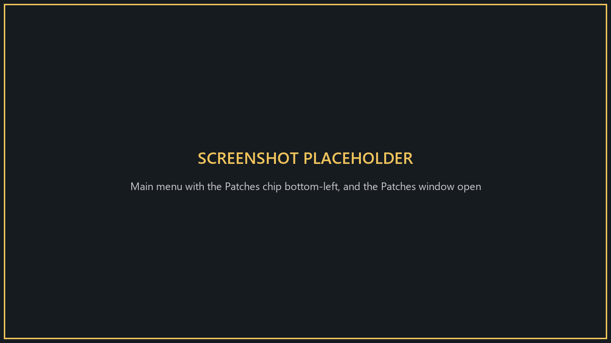

## Game version
The code in this repo is ported to **EA 0.4.0** (Steam build 26212298), the current game. The [releases](https://github.com/medovanx/mimesis-patches/releases), which the installer, Thunderstore and the Linux tool's `--source github` install, are still the **EA 0.3.1** builds, and on EA 0.4.0 several of them don't work:
- No release shows the **Patches** chip on the main menu (the game renamed the text it looks for), so no patch's options can be changed in game.
- **BiggerLobby 1.5.7**: lobbies still hold 10, but its result screen patch no longer fits the game and stops the rest from loading: no difficulty scaling and no 10-player spectator list. Its player list is for the old pause menu, which the game no longer opens.
- **HostOptions 1.4.4**: Infinite Stamina and Starting money never show in the lobby (they were in the old Esc menu).
- **Inventory 1.4.4**: made for the old inventory (2 × 4 grid). EA 0.4.0 redesigned it and removed or changed HUD parts the patch uses.
- **LateJoin 1.2.3**: does nothing (the game now handles mid-run joins itself).
- **HudPercent 1.3.4** and **PSController 1.5.4**: made for the old HUD bars and controller prompts, which EA 0.4.0 replaced.

Fov, FpsCounter, Minimap, Revive and SpectatorCam still work, apart from the chip and the fixes listed below. Until there are releases for EA 0.4.0, use builds of this code: build them yourself (see [Build](#build); on Linux the [Linux tool](#linux-steam--proton) does it for you), or get them from a friend who did (see [Playing with friends](#playing-with-friends)). Changes for 0.4.0 are in each patch's CHANGELOG under *Unreleased*:
- **Ported to the game's new UI and systems**: BiggerLobby (pause menu, result screens, spectator list, room lists), HostOptions (moved to the TRAM Settings window), HudPercent (new health graph and radiation gauge), Inventory (new inventory with bag slots), LateJoin (the game now does mid-run joins itself), PSController (new controller prompts), and the Patches chip on the new main menu (all patches).
- **Fixed for new game features**: Fov ([ and ] while typing in TRAM Settings), SpectatorCam (mimic possession and the F9 form).
- **Also fixed**: Revive no longer revives anyone once the level is decided (an older bug).
- **Checked, no changes needed**: Minimap and FpsCounter (apart from the shared Patches window changes).

## Install
On EA 0.4.0, read [Game version](#game-version) first: the installer installs the EA 0.3.1 builds.

1. Download **`MimesisPatchesInstaller.exe`** from the [Releases page](https://github.com/medovanx/mimesis-patches/releases).
2. Run it, tick the patches you want and click **Install / update selected**. It installs MelonLoader for you if you don't have it, and moves older installs over automatically. See [Installer](Installer/).
3. In game, click the **Patches** chip in the bottom-left of the main menu to turn patches on/off and change their options. It turns orange when an update is available.

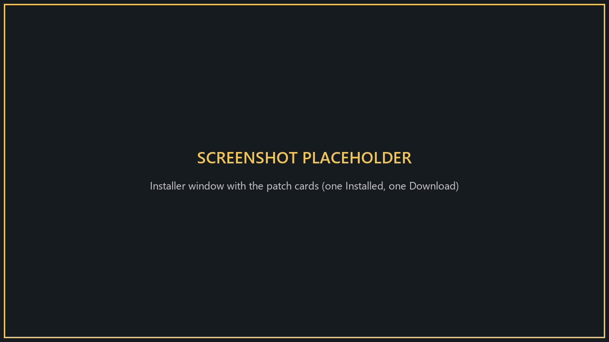

The mods are also coming to Thunderstore (team medovanx, MIMESIS community), so you'll be able to install them with r2modman or Gale.

To install by hand instead: install [MelonLoader](https://github.com/LavaGang/MelonLoader/releases) (x64, 0.7.x) into the game folder and run the game once, then copy `<Patch>Runtime.dll` from the patch's [release](https://github.com/medovanx/mimesis-patches/releases) into the game's `Mods` folder.

## Linux (Steam / Proton)
MIMESIS only ships for Windows, so on Linux and Steam Deck Steam runs it with Proton. The patches work there too: install them with [`linux/mimesis-patches.py`](linux/) instead of the Windows installer. It needs Python 3.8+ and, to build the patches for the current game, the **.NET SDK 8** or newer ([how to install it](linux/README.md#building)):

```sh
git clone https://github.com/medovanx/mimesis-patches
cd mimesis-patches
python3 linux/mimesis-patches.py install      # all patches; or e.g. install Fov Minimap
```

It finds the game in your Steam libraries (also Flatpak and Snap Steam), builds the patches against your copy of the game, installs MelonLoader and sets the Wine DLL override that makes Proton load it, so no launch options are needed. Without the .NET SDK (and no builds in `dist/`) it installs the GitHub releases instead, the EA 0.3.1 builds: check that its `Source:` line says *local builds*. `status` shows what's installed, `uninstall` removes patches. Start the game from Steam as usual. See [linux/README.md](linux/README.md) for all commands and options.

In game, the Patches window still shows when an update is available. Under Proton its Update buttons don't run the Windows installer: they show the command that updates your install, with a Copy button.

## Patches

| Patch | Version | Host | Player | What it does |
|---|---|---|---|---|
| [BiggerLobby](BiggerLobby/) | 1.5.7 | Yes | For the 10-player UI | 10-player lobbies, with UI for 10 and difficulty that scales with player count |
| [PSController](PSController/) | 1.5.4 | Optional | Optional | PlayStation button icons instead of Xbox ones |
| [SpectatorCam](SpectatorCam/) | 1.3.3 | Optional | Optional | Free spectator camera, limited to the area around the player you're watching |
| [Minimap](Minimap/) | 1.6.5 | Optional | Optional | Minimap: explored or full map, plain or graphic, optional players/monsters/items |
| [HostOptions](HostOptions/) | 1.4.4 | Yes | No | Lobby options: infinite stamina, starting money, difficulty and economy |
| [Inventory](Inventory/) | 1.4.4 | Yes | Yes | 1-8 inventory slots, set by the host (slots 5-8 are the game's bag slots) |
| [LateJoin](LateJoin/) | 1.2.3 | Yes | Yes | Join a game in progress: reach the tram while the team is away and you wait there for them, instead of going back to the menu |
| [Fov](Fov/) | 1.5.4 | Optional | Optional | Field of view setting; [ and ] change it in game |
| [Revive](Revive/) | 1.2.3 | Yes | No | Stand next to a dead teammate to revive them |
| [HudPercent](HudPercent/) | 1.3.4 | Optional | Optional | Health and radiation percentages next to the HUD bars |
| [FpsCounter](FpsCounter/) | 1.1.4 | Optional | Optional | Frame rate in the bottom-right corner |

**Host / Player**: who needs the patch. *Yes* = required, *No* = not needed, *Optional* = personal feature, install it if you want it.

## Playing with friends
Friends who join need the patches with *Yes* in the Player column (BiggerLobby too for the 10-player UI), and on EA 0.4.0 they need builds of this code, like the host, not the releases (see [Game version](#game-version)). The releases have the same version numbers, so the Patches window can't tell them apart: check where everyone got theirs.

A build is one file per patch, `<Patch>Runtime.dll`, and the same file works on Windows and Linux. To get them:
- **Build them**: on Windows, see [Build](#build) (each DLL ends up in `<Patch>/Runtime/bin/Release/net472/`). On Linux, `python3 linux/mimesis-patches.py install` builds and installs them.
- **Or use the host's**: they're in the host's `dist/` folder (Linux tool) or `<Patch>/Runtime/bin/Release/net472/`. On Windows, install MelonLoader (by hand or with the installer, see [Install](#install)) and copy the DLLs into the game's `Mods` folder. On Linux, clone this repo, put the DLLs in its `dist/` folder and run `python3 linux/mimesis-patches.py install --no-build`.

On Windows, don't click the installer's **Install / update selected** while you use these builds: it puts the EA 0.3.1 release builds back.

## Screenshots
Taken on EA 0.3.1, so some screens look different on EA 0.4.0: HostOptions' controls are in the lobby's TRAM Settings window (F1), Inventory's slots 5-8 are the game's bag row, and the menus are new.

<table>
<tr><td align="center"><a href="BiggerLobby/">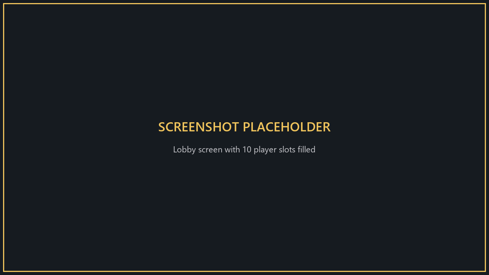<br>BiggerLobby</a></td><td align="center"><a href="PSController/">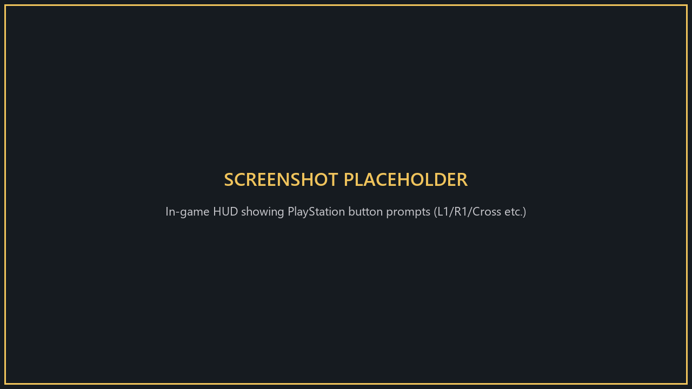<br>PSController</a></td><td align="center"><a href="Minimap/">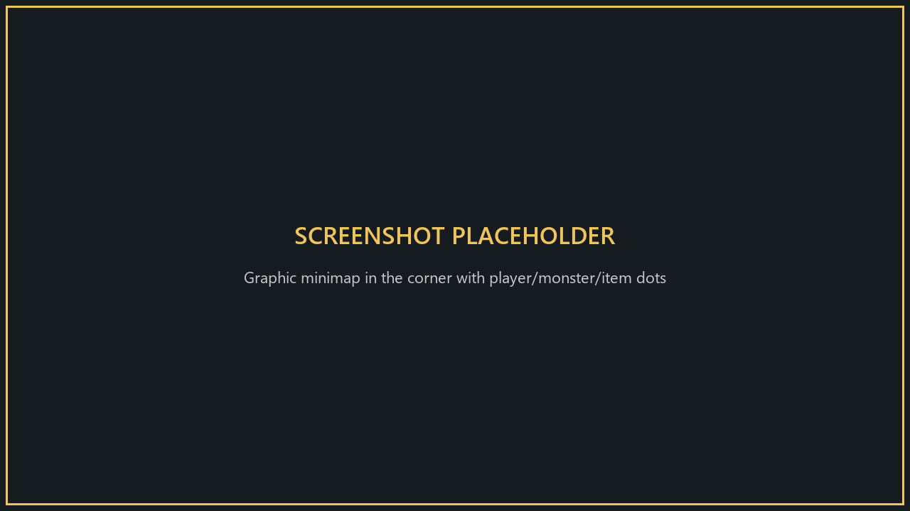<br>Minimap</a></td></tr>
<tr><td align="center"><a href="HostOptions/">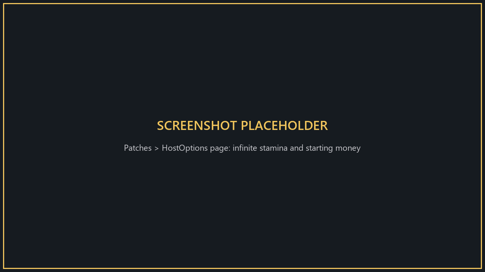<br>HostOptions</a></td><td align="center"><a href="Inventory/">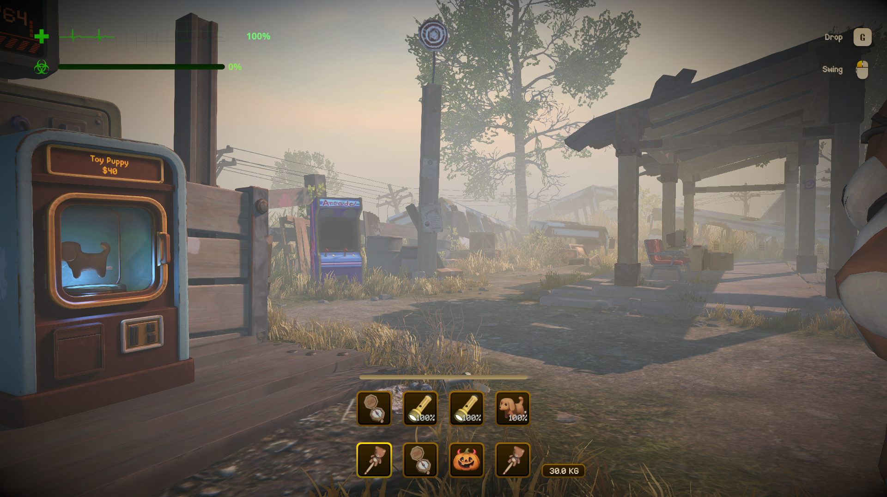<br>Inventory</a></td><td align="center"><a href="Fov/">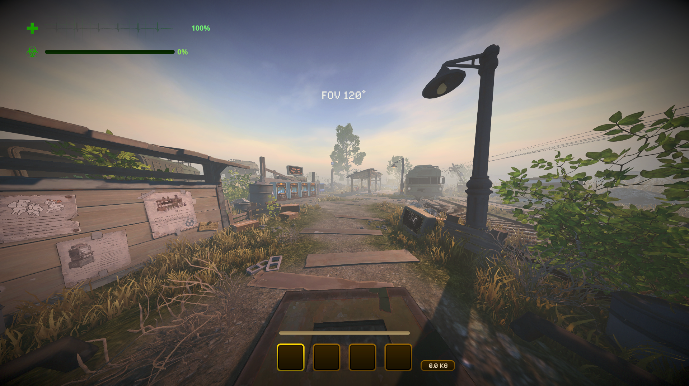<br>Fov</a></td></tr>
<tr><td align="center"><a href="HudPercent/">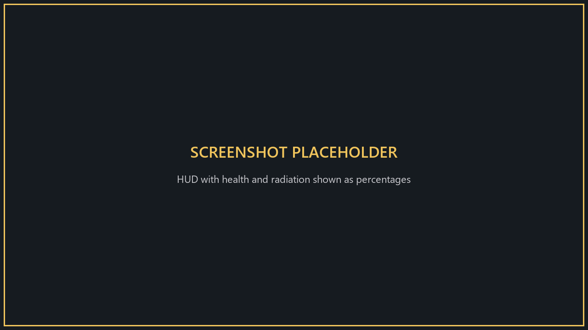<br>HudPercent</a></td><td align="center"><a href="SpectatorCam/">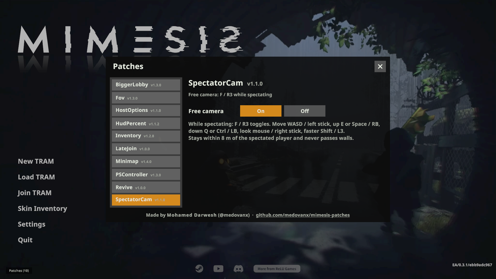<br>SpectatorCam</a></td><td align="center"><a href="LateJoin/">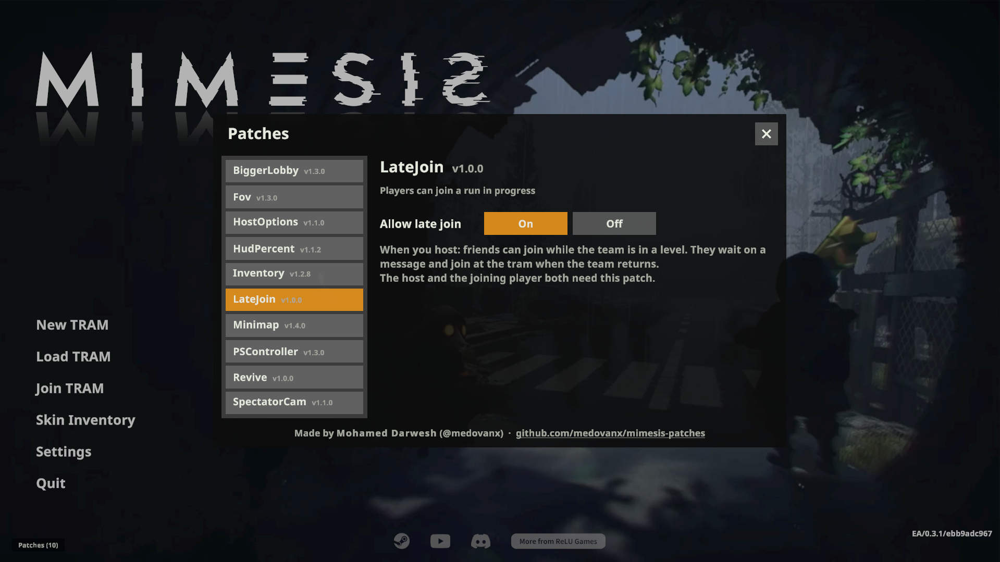<br>LateJoin</a></td></tr>
<tr><td align="center"><a href="Revive/">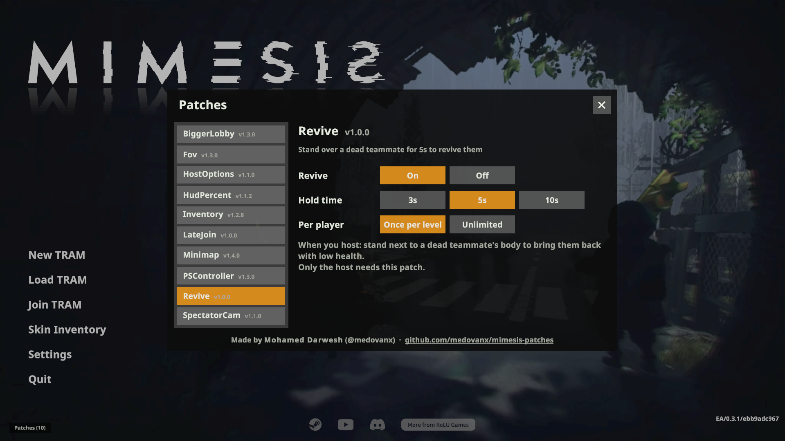<br>Revive</a></td></tr>
</table>

## Uninstall
Run the installer and click **Uninstall selected** or **Uninstall all**, or delete the patch's DLL from the game's `Mods` folder. MelonLoader stays installed. Installed with Gale or r2modman? Remove or disable it there instead.

## Build
The patches build with the .NET SDK 8 or newer; the Windows installer in `Installer/` needs the .NET 10 SDK. Run `dotnet build -c Release` in `<Patch>/Runtime`. The builds find the game on their own when the repo is cloned into the game folder as `Patches` (next to `MIMESIS.exe`), from the `MIMESIS_DIR` environment variable, or on Linux in the default Steam, Flatpak or Snap Steam library. Otherwise pass `-p:GameDir="<path to the MIMESIS folder>"`. On Linux, `python3 linux/mimesis-patches.py build` builds them all into `dist/`. The MelonLoader reference comes from NuGet (`LavaGang.MelonLoader`). `Common/` holds code shared by all patches.

See [CHANGELOG.md](CHANGELOG.md) for what changed in each version.


## Releasing
`python tools/release.py Fov HostOptions --note "What changed" --token tss_...` bumps the version, updates the CHANGELOG (the note, then what's under *Unreleased*) and README, builds, commits, creates the GitHub release (installer and in-game updates) and uploads to Thunderstore (Gale / r2modman). Add `--minor` for a minor version, `--no-thunderstore` for GitHub only, `--dry-run` to preview. The token is a Thunderstore service account token (Teams > medovanx > Service accounts).

## AI disclosure
These mods were made with the help of an AI coding assistant (Claude, by Anthropic): code, documentation and icons.
